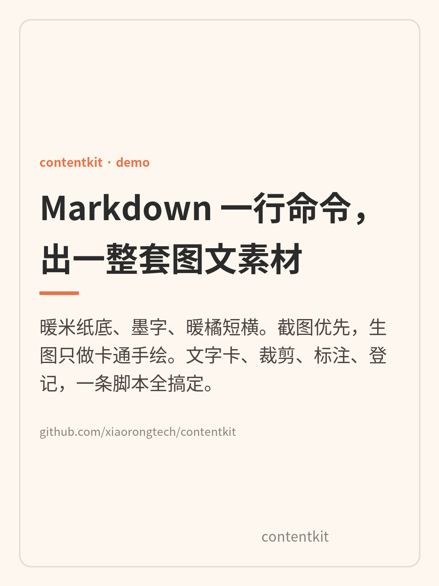
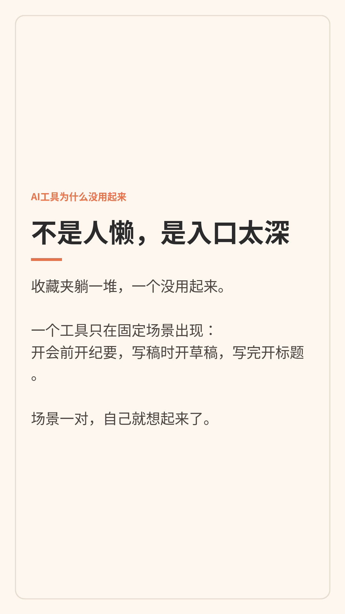

<div align="center">

# contentkit

**Markdown 一行命令，出一整套多平台图文/视频素材。**

自媒体人把「写完文案之后」的那段时间压缩到零：
截图、裁剪、标注、文字卡、幻灯片视频、飞书通知、浏览器分发——一个工具箱搞定。

[](LICENSE)



</div>

## 你能做什么

- 截图某个应用窗口，裁剪关键区，标重点 → 步骤图
- 一条命令出小红书 3:4 / X 方图 / 竖版文字卡
- 多张卡片拼成 1080×1920 视频（带顶底字幕）
- 浏览器分发：已登录页面自动填好 + dry-run 存档
- 飞书卡片通知
- 按 systemd 每 5 分钟防息屏锁屏

## 产品价值

自媒体人做内容，时间往往不是花在写作上，而是花在**收尾**上：

- 写完文案，要配图 → 打开 PS 拼一小时
- 需要一张「重点圈出来」的截图 → 手动截、手动画框
- 要发抖音图文 → 又要排版一遍
- 每天要给自己汇报数据 → 手动翻后台记数

这些活儿重复、琐碎、吃掉创作时间。contentkit 把它们做成命令行，让你**只做决定，剩下给脚本**。

**给谁**：在 Linux/macOS 上日更小红书/X 的独立博主。

## 功能

| 能力 | 命令 | 解决什么 |
|---|---|---|
| 应用窗口截图 | `imagetool.py shot --app Feishu` | 比全屏截图有价值得多，只截关键窗口 |
| 裁剪聚焦 | `imagetool.py crop --box x,y,w,h` | 只留关键区域，信息密度翻倍 |
| 重点标注 | `imagetool.py mark` | 红框 + 编号 + 箭头，步骤图一目了然 |
| 文字卡 | `imagetool.py card --size xhs` | 小红书 3:4 / X 方图 / 竖版故事，一条命令出图 |
| 素材登记 | `imagetool.py log` | 提示词/抽卡次数/是否采用，自动记 CSV 复盘 |
| 幻灯片视频 | `tools/make_video.py --subtitle "顶\|底"` | 多张卡片拼 1080×1920 视频 + 顶底字幕（ffmpeg） |
| 浏览器分发 | `tools/dispatch.py x-post` | 已登录浏览器自动填入发帖，默认 dry-run 存档，`--send` 才发送 |
| 飞书通知 | `tools/notify_feishu.py` | 定时把运营情况推到飞书卡片 |
| 看门狗 | `tools/keep-awake.sh` | systemd 服务，每 5 分钟防息屏锁屏 |

### 浏览器分发（dispatch）

> **前置条件：** 必须在宿主权限下运行。沙箱内读不到宿主窗口，**沙箱里跑这节命令会失败**，先在主机检索完再跑 dispatch。

```bash
# 看当前页面结构（找 ref）
python3 tools/dispatch.py snap --app chrome --grep 发布

# X 发帖（默认 dry-run：填好截图，不点发送）
python3 tools/dispatch.py x-post --text "内容…"

# 确认草稿没问题后，再加 --send 真发
python3 tools/dispatch.py x-post --text "内容…" --send

# 截图存档
python3 tools/dispatch.py shot --app chrome --out x-compose
```

安全语义：dispatch 默认**只填不发**。截图存在 `content/assets/`，加 `--send` 才真正点发送按钮。

## 视觉规范（固定，不换）

暖米纸底 `#FDF7EF`、墨字 `#2B2B2B`、暖橘强调 `#E8734A`、细线 `#E6DCD0`。
一套配色用到底，就是账号的辨识度——不要每张换风格。

## 快速开始

```bash
git clone https://github.com/xiaorongtech/contentkit.git
cd contentkit

# 依赖：Python 3 + ImageMagick（convert）+ 中文字体 Noto Sans CJK
python3 tools/imagetool.py card \
  --kicker "AI 实测 #01" \
  --title "标题最多两行" \
  --body "正文 3-5 行" \
  --footer "@你的账号" --out cover
# → cover.png

python3 tools/imagetool.py shot --app Feishu --out feishu-ui
python3 tools/imagetool.py crop --in feishu-ui.png --box 300,200,800,500 --out focus
python3 tools/imagetool.py mark --in focus.png --out marked --box "40,20,300,80,1"

# 幻灯片视频（ffmpeg）
python3 tools/make_video.py --images cover.png content.png --out out.mp4 --per 3 \
  --subtitle "顶栏1|底栏1" --subtitle "顶栏2|底栏2"
# → out.mp4（1080×1920，h264+aac）
```

## 示例

`examples/` 里有真实产出的卡片和截图，全部由本工具生成。




## 原则

见 [docs/roadmap.md](docs/roadmap.md) 和仓库内的示例规范。原则的详情在 docs/，这里只留一句话：图是加分项，不是必需品。

## License

MIT
